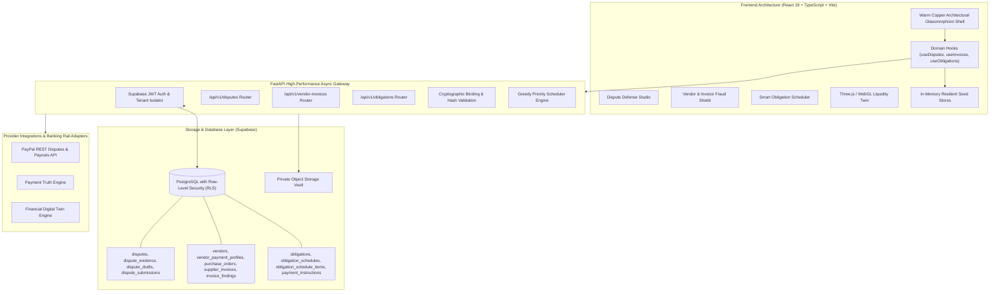

<p align="center">
  
</p>

<h1 align="center">FinCora AI</h1>

<p align="center">
  <strong>Autonomous Financial Defense & Dynamic Liquidity Twin for Modern Enterprises</strong>
</p>

<p align="center">
  <a href="#tech-stack"></a>
  <a href="#tech-stack"></a>
  <a href="#tech-stack"></a>
  <a href="#tech-stack"></a>
  <a href="#tech-stack"></a>
  <a href="#tech-stack"></a>
  <a href="#tech-stack"></a>
</p>

---

## 📌 Executive Overview

**FinCora AI** is an enterprise-grade autonomous financial operations platform designed to defend corporate capital, eliminate supplier invoice fraud, resolve payment provider disputes, and optimize future liquidity.

Built on the **Warm Copper Architectural Glassmorphism** design system, FinCora combines deterministic mathematical verification engines with explainable AI reasoning. Rather than delegating authoritative balance calculations or financial disbursements to black-box models, FinCora AI operates on strict separation of powers:
- **AI Orchestration:** Synthesizes chronologies, generates grounded rebuttal drafts with direct citation anchors, and extracts structured invoice data.
- **Deterministic Guardrails:** Enforces immutable tenant boundaries, cryptographic approval payloads, three-way purchase order matching, and hard reserve floors.

---

## 🏛 System Architecture

FinCora AI adopts a multi-tier decoupled architecture with zero-trust tenancy:



---

## 🚀 Newly Implemented Full-Stack Modules

### 1. 🛡️ Dispute Defense Studio
A merchant-side case management and preparation studio designed to prevent revenue loss from chargebacks and payment disputes.
- **Evidence Timeline & Linker:** Automatically reconciles disputed transaction IDs against Payment Truth records, orders, invoices, and shipping carriers (e.g., FedEx proof of delivery).
- **Deterministic Checklist Engine:** Maps provider reason codes (such as `MERCHANDISE_OR_SERVICE_NOT_RECEIVED`) to strict evidentiary criteria, marking items as `available`, `missing`, or `review_required`.
- **Explainable AI Case Briefs:** Employs LLM synthesis to draft point-by-point rebuttal letters where every factual statement explicitly cites verified evidence tokens (e.g., `[EVID-001]`).
- **Cryptographic Submission Approval:** Binds the draft response, evidence checksums, and provider dispatch destination into an immutable signed approval record prior to submission.
- **Interactive Evidence Drawer:** Offers full-fidelity modal inspection of original artifacts, OCR extraction confidence ratings, and audit timestamps.

### 2. 🔍 Vendor & Invoice Fraud Shield
A pre-payment control gate that inspects inbound supplier invoices before any outgoing disbursement can be scheduled or approved.
- **Automated Three-Way Matching:** Cross-references invoice line items, quantities, and prices against verified Purchase Orders (`PO-8812`) and delivery receipts with configured tax tolerances.
- **Duplicate & Near-Duplicate Detection:** Prevents double-payment by matching normalized invoice numbers, vendor aliases, dates, amounts, and document digital hashes.
- **Beneficiary Remittance Guardrails:** Detects first-time or modified bank account / wire routing instructions and immediately flags the invoice for manual out-of-band verification.
- **Explainable Risk Findings:** Generates transparent risk diagnostics detailing the mismatched fields without reliance on opaque scoring models.
- **Approve / Hold Workflows:** Places suspicious invoices on hard payment holds and allows authorized finance managers to override with audit-logged justifications.

### 3. 📅 Smart Obligation Scheduler
A cash-aware optimization engine that schedules enterprise obligations while preserving capital liquidity.
- **30-Day Forward Cash Trajectory:** Evaluates upcoming accounts payable against dated cash inflows and known baseline outflows.
- **Reserve Floor Enforcement:** Hard-coded to safeguard an executive minimum liquidity reserve (calibrated to a default **$15,000.00** buffer), instantly warning if a payment sequence risks a breach.
- **Greedy Priority Discount Optimizer:** Prioritizes obligations based on early-payment discount capture (e.g., 2/10 Net 30 terms) while actively avoiding late fees and penalties.
- **Multi-Scenario Simulation:** Allows interactive stress-testing under `Baseline Forecast`, `Delayed Inflows`, `Conservative Low Sales`, and `Stress Shock` conditions.
- **Execution & Reminders:** Dispatches approved payouts through verified payment adapters or generates external reminders clearly labeled as "Not Yet Paid".

---

## 💻 Tech Stack Specification

| Tier | Technologies | Purpose |
| :--- | :--- | :--- |
| **Frontend Framework** | **React 19**, **TypeScript 5.5** | Component-driven UI architecture with complete type safety |
| **Build & Tooling** | **Vite 5.4**, **ESBuild** | Rapid Hot Module Replacement (HMR) and optimized client bundling |
| **Design & Styling** | **Tailwind CSS v3**, **Warm Copper Glassmorphism** | Cohesive architectural glassmorphic design language with tone glow |
| **3D & Visualizations** | **Three.js**, **@react-three/fiber**, **Canvas** | Interactive WebGL financial terrain, radar, and digital twin scrubbers |
| **Icons & Visuals** | **Lucide React** | Modern, clean iconography across all dashboards and modals |
| **Backend Framework** | **FastAPI (ASGI)**, **Starlette** | High-concurrency Python API endpoints with automatic OpenAPI documentation |
| **Validation & Schema** | **Pydantic v2** | Strict bidirectional serialization and schema validation |
| **Database & Auth** | **Supabase PostgreSQL 15+**, **Row-Level Security (RLS)** | Multi-tenant relational storage with workspace isolation |
| **Async Database Pool** | **Asyncpg** | Native asynchronous PostgreSQL connectivity |
| **Testing Suite** | **Vitest 2.1**, **React Testing Library** | Unit, integration, and stress verification (960+ passing tests) |

---

## ⚡ Quick Start & Installation Guide

### Prerequisites
- **Node.js**: `v18.0.0` or newer
- **Python**: `3.11.x` (recommended)
- **Git**

---

### Step 1: Clone the Repository
```bash
git clone https://github.com/your-org/fincora.git
cd fincora
```

---

### Step 2: Backend Setup (FastAPI)

1. Create and activate a Python 3.11 virtual environment:
   ```bash
   # On macOS/Linux:
   python3 -m venv backend/.venv
   source backend/.venv/bin/activate

   # On Windows (PowerShell):
   python -m venv backend\.venv
   .\backend\.venv\Scripts\Activate.ps1
   ```

2. Install backend dependencies:
   ```bash
   pip install -r backend/requirements.txt
   ```

3. Configure environment variables:
   ```bash
   cp .env.example .env
   ```

4. Launch the FastAPI backend server:
   ```bash
   uvicorn backend.app.main:app --host 0.0.0.0 --port 8000 --reload
   ```
   *The backend will be available at `http://localhost:8000`. Access Swagger UI docs at `http://localhost:8000/docs`.*

---

### Step 3: Frontend Setup (React + Vite)

1. Navigate to the `frontend` directory:
   ```bash
   cd frontend
   ```

2. Install dependencies:
   ```bash
   npm install
   ```

3. Configure environment variables:
   ```bash
   cp .env.example .env
   ```

4. Start the Vite development server:
   ```bash
   npm run dev
   ```
   *The client application will launch at `http://localhost:5173`.*

---

## 🧪 Running the Test Suite

FinCora AI maintains an extensive automated test suite covering unit behavior, boundary limits, and multi-actor stress scenarios:

### Frontend Tests (Vitest)
```bash
cd frontend

# Run all 51 test suites (962+ tests)
npm test

# Run tests once with full reporting
npm run test:run

# Verify TypeScript compilation and type safety
npm run typecheck
```

### Backend Route Verification
To verify that all 33+ FastAPI routes are registered and healthy:
```bash
python -c "from backend.app.main import app; [print(r.path, r.methods) for r in app.routes if hasattr(r, 'path')]"
```

---

## 🗄️ Database Migrations (Supabase)

To apply the full-stack database schema for the new defense and projection modules:
1. Locate the migration script:
   `supabase/migrations/20261112010000_fullstack_extensions.sql`
2. Run the script in your Supabase SQL Editor or apply via Supabase CLI:
   ```bash
   supabase db push
   ```
This migration provisions all 14 tables complete with tenant-isolated `workspace_id` foreign keys, unique indices, and strict Row-Level Security policies.

---

## 🔒 Security & Privacy Commitments
- **Zero-Trust Isolation:** Every database entity and API endpoint enforces strict workspace validation.
- **Untrusted Document Defense:** All uploaded PDFs, vendor invoices, and dispute attachments are treated strictly as untrusted data rather than direct prompt instructions.
- **Cryptographic Approval Chains:** All payments and evidence dispatches mandate cryptographic payload-bound signoffs before execution.
- **Honest Provider Handoff:** If a payment or dispute operation cannot be executed directly via API sandbox limits, FinCora creates an auditable manual handoff rather than reporting false completion.

---

<p align="center">
  <sub>FinCora AI · Built with precision for the modern enterprise.</sub>
</p>

Sponsor integrations and their exact credential needs, user approval rules, and H.8 readiness are documented in [docs/environment-configuration.md](docs/environment-configuration.md). The app includes AG Studio and Bryntum trial views, Channel3 product search, private Elastic evidence indexing, KERNEL public-page retrieval, allowlisted Zapier MCP actions, an idempotent Render Workflow, the APIMatic-generated PayPal Server SDK, and a Postman collection. External account setup and license requirements still apply; adapter presence does not mean hosted judge evidence has been completed.

See [PROJECT.md](PROJECT.md) for the product and architecture brief, [TEST_INFRA.md](TEST_INFRA.md) for the test strategy, and [docs/environment-configuration.md](docs/environment-configuration.md) for the environment-variable inventory and integration status.
